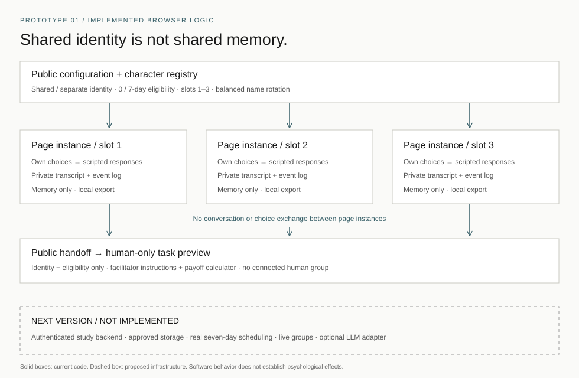

# Prototype 01 — technical specification

Version: 0.1.0. Status: scripted browser MVP; research deployment not implemented.

## Technical assumption

Can separate page instances use the same continuing character identity, respond to different local choices, and keep those choices out of other sessions and the group handoff?

This is narrower than asking whether people form relationships with a character or change their later cooperation. It is the smallest assumption that the software can directly test.

## Architecture

| Component | Current responsibility |
| --- | --- |
| `prototype.html` | Accessible configuration, disclosure, chat choices, handoff, illustrative payoff, local export/reset |
| `engine.mjs` | Configuration validation, identity mapping, deterministic responses, state transitions, timestamps, event records, payoff arithmetic |
| `app.mjs` | DOM rendering using text nodes, input locking, per-page session state, independent-session links, explicit local downloads |
| `prototype.css` | Responsive layout, visible controls and focus styles; inherits the portfolio's typography and accent |
| GitHub Pages | Serves static files over HTTPS; no application backend or research database |

The character registry has three public identities with the same principle and response policy. In the shared condition, all slots use the selected character. In the separate condition, slots use different names; rotation shifts names across slots. This is configurable assignment, not randomized recruitment or complete counterbalancing of an actual sample.

## State and transitions

`Configuration → Private exchange (3 turns) → Ready for handoff → Group-task preview → Complete`

Configuration is locked at session start. Each page holds one `session` in a module-local variable. A fresh ID is generated locally. Engine functions return new state objects rather than appending to another session's arrays.

| State field | Purpose | Boundary |
| --- | --- | --- |
| `config`, `character` | Public condition and continuing identity | May appear in launch URLs and handoff |
| `choices`, `messages` | Bounded selections and scripted transcript | Current page only; included only in that visitor's explicit local export |
| `events` | Ordered software actions with ISO timestamps | Current page only; not uploaded |
| `completedAt`, `eligibleAt` | Completion and intended meeting time | Eligibility is completion + 0 or 7 × 24 hours |
| `clockSimulated` | Distinguish an early demo shortcut | Logged and displayed; never interpreted as elapsed follow-up |

The handoff whitelist contains slot, character name, identity condition, delay, eligibility timestamp, preview stage, and facilitator requirement. It excludes choices, conversation, and the local session ID. No cross-participant matching or transmission service is implemented.

## Data boundaries

- No `localStorage`, `sessionStorage`, cookies, model calls, `fetch`, analytics SDKs, or research collection endpoints are used by the prototype code.
- Independent links contain public configuration only and use `noopener noreferrer`. A shared identity does not carry private memory.
- Three fixed-choice turns avoid free-text personal disclosures. Responses depend only on this session's own choices.
- Reset clears page state and visible transcript/logs. Departure clears the session; back/forward restoration requires a fresh session. Existing downloads remain on the visitor's device.
- A JSON export contains the visitor's choices, transcript, events, and explicit `notResearchData: true`. It is not a dataset of recruited participants.
- This is application-level separation in a public demo, not authentication, encrypted research storage, or a security assessment. Browser owners, extensions, and developer tools can inspect their own page. GitHub receives ordinary hosting requests.

## Interaction design

A scripted character helps the visitor think about a low-stakes newcomer welcome activity. The first choice varies a starting preference; later choices consider disagreement and a decision principle. The same character continues through all three turns. It does not claim a human identity, intimate relationship, therapeutic role, or knowledge of other conversations.

The group stage removes the character and describes an independent first cooperation decision followed by a 12-minute human-only discussion. The three-slider calculator explains the specified payoff rule. All slider values are hypothetical inputs from one visitor, are not logged as cooperation outcomes, and trigger no payment. There is no synchronous group discussion.

## Technical choices and trade-offs

**Vanilla HTML/CSS and ES modules:** maintain the existing site and avoid a framework/build dependency. Modern browsers and a local HTTP server are sufficient. GitHub Pages is compatible with this static code.

**Deterministic branching:** reproducible and easy to audit; no secret key or model variance. It cannot sustain open conversation, demonstrate LLM behavior, or guarantee a relational experience. Evaluate the interaction before deciding whether a richer scripted, Wizard-of-Oz, or generative version is needed.

**Memory-only sessions:** minimal retained information and clear page boundaries. Reload loses progress; real seven-day scheduling and longitudinal linkage require a backend. A browser clock is not tamper-resistant.

**Public controls:** useful for reviewers and technical checks; unblinded and unsuitable for confirmatory participants. A study deployment must assign and lock conditions server-side and hide irrelevant design information.

## Next-version requirements

1. Supervisor review and ethics approval of interaction content, consent, data handling, retention, withdrawal, and payment rules.
2. Authenticated, random study IDs and group assignment; authorization checks on every private record. Keep character specification separate from participant memory.
3. Approved server storage, scheduling, reminders, and linkage for delayed meetings. Export a reproducible configuration/version manifest.
4. Study administration for independent decisions and human-only discussion. Avoid exposing others' decisions before commitment.
5. If adding an LLM: server-side credentials, versioned prompts and model settings, a session-only context builder, transcript isolation tests, provider/retention review, logging and failure handling. No API key in public JavaScript. An LLM is optional, not a prerequisite for testing identity cues.

## Minimal test plan

Automated checks cover identity mapping, rotation, invalid input, independent state, whitelisted handoff, legal transitions, seven-day arithmetic and simulation labeling, copied exports, event sequences, and payoff bounds. Static checks cover local paths/anchors, main navigation, script modules, and protected empirical numbers/statuses. Live browser checks cover the visible journey, condition controls, reset, export, and actual page rendering; report only checks actually completed.

No software test is a usability study, manipulation check, behavioral pilot, or confirmatory result. See [verification report](verification.md).
